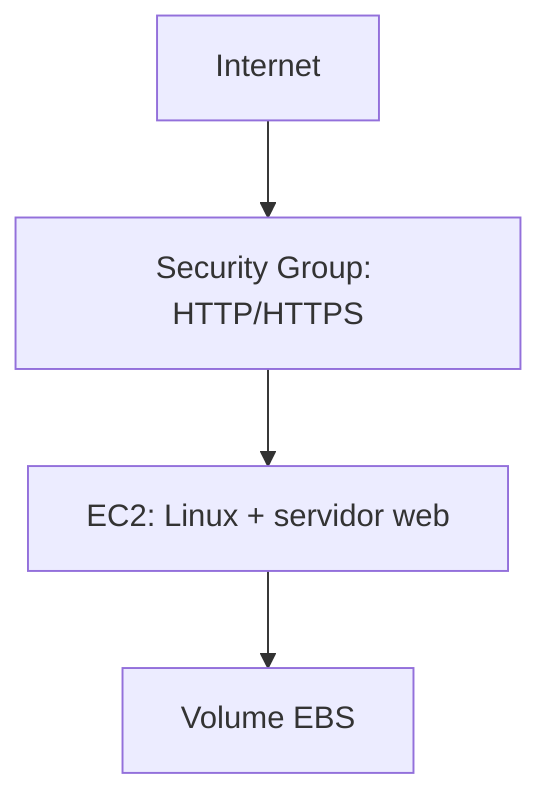

☁️ Projeto — Servidor Web com Amazon EC2


---

 🎯 Objetivo

Implantar um servidor web em uma instância EC2 e configurar regras de acesso.

 🛠️ Serviços e tecnologias

| Tecnologia | Aplicação no projeto |
|---|---|
| EC2 | Componente do ambiente; conferir configuração específica nas evidências |
| Security Groups | Componente do ambiente; conferir configuração específica nas evidências |
| EBS | Componente do ambiente; conferir configuração específica nas evidências |

🏗️ Arquitetura da solução

> Diagrama conceitual para documentação. Confirme se corresponde ao ambiente realmente implementado.



 📋 Etapas de implementação

1. Criar instância EC2 e selecionar AMI
2. Configurar Security Group conforme portas realmente utilizadas
3. Instalar e iniciar servidor web
4. Testar acesso e registrar resultado

 💻 Scripts e comandos

## 💻 Script User Data

```bash
#!/bin/bash

# Atualizar os pacotes
yum update -y

# Instalar o servidor Apache
yum install -y httpd

# Habilitar o Apache na inicialização
systemctl enable httpd

# Iniciar o servidor Apache
systemctl start httpd

# Criar a página HTML
cat > /var/www/html/index.html <<'EOF'
<!DOCTYPE html>
<html lang="pt-BR">
<head>
    <meta charset="UTF-8">
    <title>Servidor Web AWS EC2</title>
</head>
<body>
    <h1>Meu primeiro servidor web na AWS!</h1>
    <p>Projeto desenvolvido utilizando Amazon EC2, Linux e Apache.</p>
    <p>Status: Servidor funcionando com sucesso!</p>
</body>
</html>
EOF

# Verificar o status do Apache
systemctl status httpd --no-pager
```


 📸 Evidências

Envie imagens para a pasta [`evidencias/`](./evidencias/) e insira aqui as referências, por exemplo:

```markdown

```

✅ Resultados e aprendizados

💡 Aprendizados
✅ Processo de criação e configuração de uma instância EC2
✅ Uso do User Data para automatizar a instalação de serviços no boot
✅ Papel dos Security Groups no controle de acesso à instância
✅ Importância do Amazon EBS como armazenamento persistente
✅ Como redimensionar tipo de instância e volume de armazenamento
✅ Proteção contra término acidental de instâncias em produção

