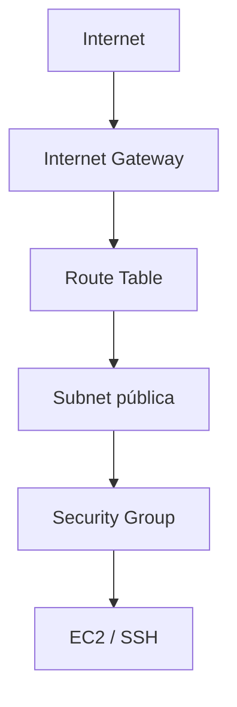

# ☁️ Projeto — VPC, Servidor Web e Acesso SSH

**Serviços:** VPC · Subnets · IGW · Route Tables · SSH  
**Origem:** Escola da Nuvem  
**Status:** 🟢 Documentação inicial — revisar com evidências

---

## 🎯 Objetivo

Construir conectividade básica em rede virtual e acessar uma instância por SSH.

## 🛠️ Serviços e tecnologias

| Tecnologia | Aplicação no projeto |
|---|---|
| VPC | Componente do ambiente; conferir configuração específica nas evidências |
| Subnets | Componente do ambiente; conferir configuração específica nas evidências |
| IGW | Componente do ambiente; conferir configuração específica nas evidências |
| Route Tables | Componente do ambiente; conferir configuração específica nas evidências |
| SSH | Componente do ambiente; conferir configuração específica nas evidências |

## 🏗️ Arquitetura da solução

> Diagrama conceitual para documentação. Confirme se corresponde ao ambiente realmente implementado.



## 📋 Etapas de implementação

1. Criar ou selecionar VPC
2. Definir subnet e rota de acesso
3. Configurar regras de segurança
4. Conectar via SSH e validar conectividade

## 💻 Scripts e comandos

Adicione aqui **somente comandos realmente utilizados**, após remover senhas, chaves, IDs privados e outros dados sensíveis.

```bash
# Exemplo de espaço reservado — substitua pelos seus comandos reais
```

## 📸 Evidências

Envie imagens para a pasta [`evidencias/`](./evidencias/) e insira aqui as referências, por exemplo:

```markdown

```

## ✅ Resultados e aprendizados

Descreva o resultado que você observou e os principais aprendizados, sem afirmar testes que não foram realizados.

## 🔐 Cuidados de segurança

Não publique chaves de acesso, credenciais, arquivos `.pem`, tokens, dados pessoais, identificadores sensíveis ou configurações internas de contas.
