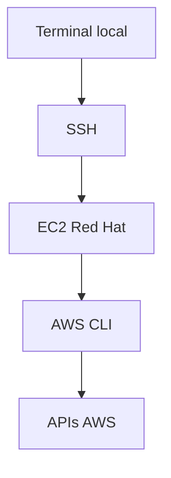

# ☁️ Projeto — AWS CLI e Linux em EC2 Red Hat

**Serviços:** EC2 · AWS CLI · SSH · Linux  
**Origem:** Prática AWS  
**Status:** 🟢 Documentação inicial — revisar com evidências

---

## 🎯 Objetivo

Executar operações e consultar recursos AWS pelo terminal Linux em uma instância Red Hat.

## 🛠️ Serviços e tecnologias

| Tecnologia | Aplicação no projeto |
|---|---|
| EC2 | Componente do ambiente; conferir configuração específica nas evidências |
| AWS CLI | Componente do ambiente; conferir configuração específica nas evidências |
| SSH | Componente do ambiente; conferir configuração específica nas evidências |
| Linux | Componente do ambiente; conferir configuração específica nas evidências |

## 🏗️ Arquitetura da solução

> Diagrama conceitual para documentação. Confirme se corresponde ao ambiente realmente implementado.



## 📋 Etapas de implementação

1. Acessar instância Red Hat por SSH
2. Verificar instalação/configuração da AWS CLI
3. Executar consultas autorizadas aos recursos
4. Registrar respostas sem expor identificadores sensíveis

## 💻 Scripts e comandos

Adicione aqui **somente comandos realmente utilizados**, após remover senhas, chaves, IDs privados e outros dados sensíveis.

```bash
# Exemplo de espaço reservado — substitua pelos seus comandos reais
```

## 📸 Evidências

Envie imagens para a pasta [`evidencias/`](./evidencias/) e insira aqui as referências, por exemplo:

```markdown

```

## ✅ Resultados e aprendizados

Descreva o resultado que você observou e os principais aprendizados, sem afirmar testes que não foram realizados.

## 🔐 Cuidados de segurança

Não publique chaves de acesso, credenciais, arquivos `.pem`, tokens, dados pessoais, identificadores sensíveis ou configurações internas de contas.
