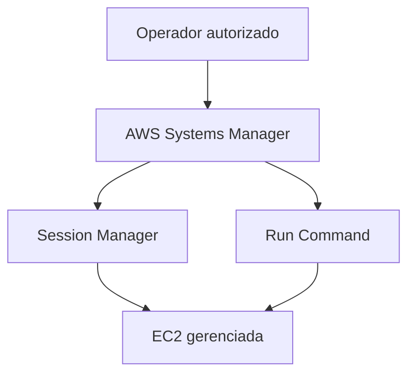

# ☁️ Projeto — Gerenciamento de Instâncias com Systems Manager

**Serviços:** SSM · Session Manager · Run Command · Parameter Store  
**Origem:** Escola da Nuvem  
**Status:** 🟢 Documentação inicial — revisar com evidências

---

## 🎯 Objetivo

Gerenciar instâncias e executar operações administrativas com ferramentas do Systems Manager.

## 🛠️ Serviços e tecnologias

| Tecnologia | Aplicação no projeto |
|---|---|
| SSM | Componente do ambiente; conferir configuração específica nas evidências |
| Session Manager | Componente do ambiente; conferir configuração específica nas evidências |
| Run Command | Componente do ambiente; conferir configuração específica nas evidências |
| Parameter Store | Componente do ambiente; conferir configuração específica nas evidências |

## 🏗️ Arquitetura da solução

> Diagrama conceitual para documentação. Confirme se corresponde ao ambiente realmente implementado.



## 📋 Etapas de implementação

1. Identificar instância gerenciada
2. Explorar Session Manager e Run Command
3. Executar atividade autorizada
4. Verificar saída e registrar resultados

## 💻 Scripts e comandos

Adicione aqui **somente comandos realmente utilizados**, após remover senhas, chaves, IDs privados e outros dados sensíveis.

```bash
# Exemplo de espaço reservado — substitua pelos seus comandos reais
```

## 📸 Evidências

Envie imagens para a pasta [`evidencias/`](./evidencias/) e insira aqui as referências, por exemplo:

```markdown

```

## ✅ Resultados e aprendizados

Descreva o resultado que você observou e os principais aprendizados, sem afirmar testes que não foram realizados.

## 🔐 Cuidados de segurança

Não publique chaves de acesso, credenciais, arquivos `.pem`, tokens, dados pessoais, identificadores sensíveis ou configurações internas de contas.
