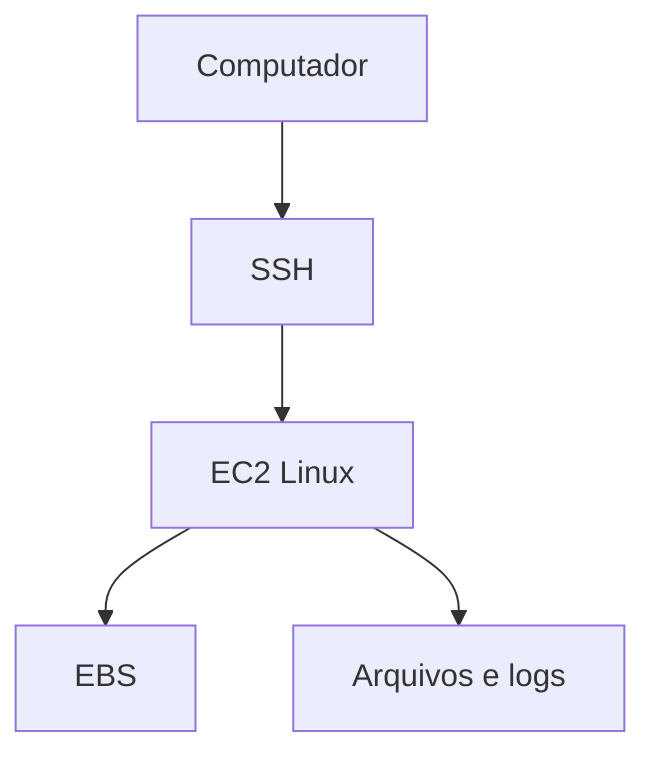

# ☁️ Projeto — Administração Linux em Amazon EC2

**Serviços:** EC2 · Linux · SSH · EBS  
**Origem:** Prática AWS  
**Status:** 🟢 Documentação inicial — revisar com evidências

---

## 🎯 Objetivo

Praticar conexão remota e administração básica de um servidor Linux na AWS.

## 🛠️ Serviços e tecnologias

| Tecnologia | Aplicação no projeto |
|---|---|
| EC2 | Componente do ambiente; conferir configuração específica nas evidências |
| Linux | Componente do ambiente; conferir configuração específica nas evidências |
| SSH | Componente do ambiente; conferir configuração específica nas evidências |
| EBS | Componente do ambiente; conferir configuração específica nas evidências |

## 🏗️ Arquitetura da solução

> Diagrama conceitual para documentação. Confirme se corresponde ao ambiente realmente implementado.



## 📋 Etapas de implementação

1. Iniciar ou acessar instância Linux
2. Conectar via SSH
3. Executar comandos básicos de administração
4. Inspecionar recursos e registrar resultados

## 💻 Scripts e comandos

Adicione aqui **somente comandos realmente utilizados**, após remover senhas, chaves, IDs privados e outros dados sensíveis.

```bash
# Exemplo de espaço reservado — substitua pelos seus comandos reais
```

## 📸 Evidências

Envie imagens para a pasta [`evidencias/`](./evidencias/) e insira aqui as referências, por exemplo:

```markdown

```

## ✅ Resultados e aprendizados

Descreva o resultado que você observou e os principais aprendizados, sem afirmar testes que não foram realizados.

## 🔐 Cuidados de segurança

Não publique chaves de acesso, credenciais, arquivos `.pem`, tokens, dados pessoais, identificadores sensíveis ou configurações internas de contas.
